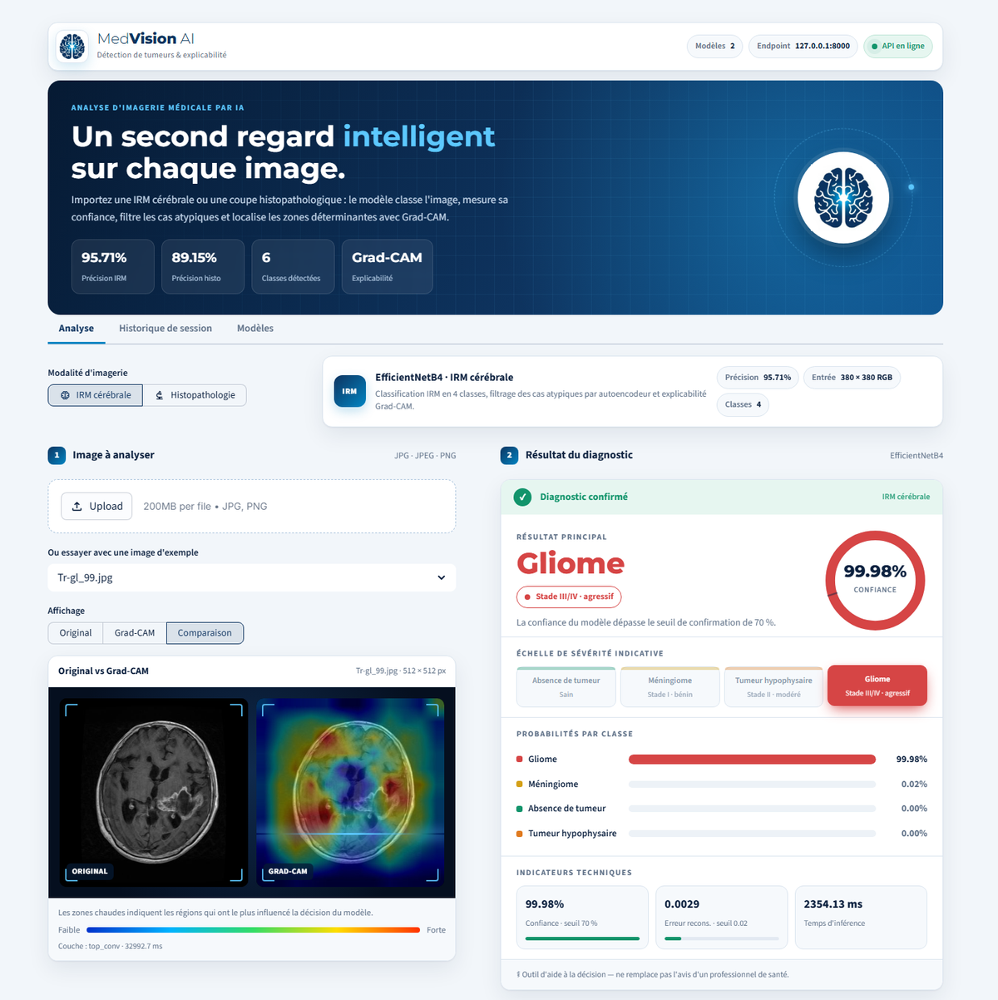

<p align="center">
  
</p>

<h1 align="center">MedVision AI — Détection de tumeurs par deep learning</h1>

<p align="center">
  Classification d'IRM cérébrales et de coupes histopathologiques mammaires,<br>
  avec filtrage des cas atypiques et explicabilité Grad-CAM.
</p>

<p align="center">
  
  
  
  
  
</p>

> ⚕️ **Outil de recherche et d'aide à la décision.** MedVision AI ne remplace pas l'avis d'un professionnel de santé. Une validation clinique est requise avant tout usage opérationnel.

<p align="center">
  
  <br><sub>Analyse réelle d'une IRM d'exemple (<code>samples/brain_mri/Tr-gl_99.jpg</code>) en mode Comparaison.</sub>
</p>

---

## Sommaire

1. [Présentation](#présentation)
2. [Fonctionnalités](#fonctionnalités)
3. [Architecture](#architecture)
4. [Modèles](#modèles)
5. [Structure du dépôt](#structure-du-dépôt)
6. [Installation](#installation)
7. [Lancement](#lancement)
8. [Utilisation de l'interface](#utilisation-de-linterface)
9. [API REST](#api-rest)
10. [Évaluation](#évaluation)
11. [Docker](#docker)
12. [Configuration](#configuration)
13. [Dépannage](#dépannage)
14. [Données et fichiers volumineux](#données-et-fichiers-volumineux)

---

## Présentation

**MedVision AI** est une application complète de diagnostic assisté par IA, composée de :

- un **backend FastAPI** qui charge trois modèles Keras et expose une API REST ;
- un **frontend Streamlit** aux couleurs de la marque, qui affiche le diagnostic, la confiance, les probabilités et la carte Grad-CAM ;
- une **base MongoDB optionnelle** pour l'historique des diagnostics.

Deux modalités d'imagerie sont prises en charge :

| Modalité | Modèle | Classes | Précision de référence |
|---|---|---|---|
| 🧠 **IRM cérébrale** | EfficientNetB4 (transfer learning, Focal Loss) | Gliome · Méningiome · Hypophysaire · Absence de tumeur | **95,71 %** |
| 🔬 **Histopathologie mammaire** | CNN personnalisé | Tissu sain · Carcinome | **89,15 %** |

---

## Fonctionnalités

**Analyse**
- Classification IRM en 4 classes et histopathologie en 2 classes.
- **Filtrage des cas atypiques** (IRM) : un autoencodeur mesure l'erreur de reconstruction. Au-delà de 0,02, l'image est signalée comme hors distribution et n'est pas classée.
- **Statut de confiance** : `CONFIRMED` (≥ 70 %), `UNCERTAIN` (< 70 %), `SUSPECT` (cas atypique).
- **Grad-CAM** (IRM) : carte des zones qui ont le plus influencé la décision.
- Endpoint **DICOM** compatible PACS (`/predict/dicom`), avec extraction des métadonnées.

**Interface**
- Logo et palette cohérents (bleu marine `#0E3460` et bleu lumineux `#0085C3`).
- Visionneuse en trois modes : **Original**, **Grad-CAM** et **Comparaison** côte à côte.
- Carte de résultat : statut coloré, diagnostic en grand, jauge de confiance avec le seuil de 70 %, échelle de sévérité, probabilités par classe et indicateurs techniques.
- **Images d'exemple** intégrées pour tester sans importer de fichier.
- **Historique de session** avec miniatures et statistiques.
- **Rapport téléchargeable** au format texte.
- Mise en page responsive (ordinateur et mobile).

---

## Architecture

```
┌──────────────────────────────┐        HTTP / JSON         ┌──────────────────────────────────────┐
│  Frontend Streamlit  :8501   │ ─────────────────────────▶ │  Backend FastAPI  :8000               │
│  streamlit/app.py            │                            │  app/main.py                          │
│                              │ ◀───────────────────────── │                                       │
│  • import / exemples         │   prédiction, Grad-CAM     │  ┌─────────────────────────────────┐  │
│  • visionneuse Grad-CAM      │                            │  │ Autoencodeur (cas atypiques)    │  │
│  • carte de résultat         │                            │  ├─────────────────────────────────┤  │
│  • historique, rapport       │                            │  │ EfficientNetB4 (IRM, 4 classes) │  │
└──────────────────────────────┘                            │  ├─────────────────────────────────┤  │
                                                            │  │ CNN histopathologie (2 classes) │  │
                                                            │  └─────────────────────────────────┘  │
                                                            └───────────────┬──────────────────────┘
                                                                            │ (optionnel)
                                                                            ▼
                                                                  MongoDB · historique
```

**Pipeline IRM :** import → autoencodeur (erreur > 0,02 ⇒ `SUSPECT`) → classification EfficientNetB4 → statut selon la confiance → Grad-CAM à la demande.

---

## Modèles

Les modèles pré-entraînés sont fournis dans `models/` :

| Fichier | Rôle | Entrée |
|---|---|---|
| `classifier_final.keras` | Classifieur IRM EfficientNetB4 (Focal Loss, γ = 2, α = 0,25) | 380 × 380 RGB, prétraitement EfficientNet |
| `autoencoder_final.keras` | Détection d'anomalies par erreur de reconstruction (MSE) | 224 × 224 RGB, normalisé 0–1 |
| `breast_classifier_final.keras` | Classifieur histopathologique | 50 × 50 RGB |
| `class_names.json` | `["glioma", "meningioma", "notumor", "pituitary"]` | — |
| `breast_class_names.json` | `["sain", "carcinome"]` | — |

**Échelle de sévérité indicative** affichée dans l'interface :

| Classe | Libellé | Stade indicatif |
|---|---|---|
| `notumor` | Absence de tumeur | Sain |
| `meningioma` | Méningiome | Stade I · bénin |
| `pituitary` | Tumeur hypophysaire | Stade II · modéré |
| `glioma` | Gliome | Stade III/IV · agressif |
| `sain` | Tissu sain | Sain |
| `carcinome` | Carcinome | Malin |

---

## Structure du dépôt

```
tumor_project/
├── app/
│   ├── main.py                 # API FastAPI : chargement des modèles, /predict, /gradcam, /predict/dicom, /history, /benchmark
│   ├── evaluate.py             # Évaluation par lot sur un dossier d'images
│   └── eval_report.json        # Dernier rapport d'évaluation
├── streamlit/
│   ├── app.py                  # Interface MedVision AI
│   ├── app_reject.py           # Ancienne interface autonome (sans API), conservée pour référence
│   ├── assets/logo.jpg         # Logo de l'application
│   └── .streamlit/config.toml  # Thème Streamlit (couleurs de la marque)
├── docs/interface.png          # Capture de l'interface
├── models/                     # Modèles Keras pré-entraînés et noms de classes
├── samples/
│   ├── brain_mri/              # Images IRM d'exemple (proposées dans l'interface)
│   └── histopathology/         # Patchs histologiques d'exemple
├── data_backup/                # Dataset IRM Training/Testing (local, non versionné — voir plus bas)
├── Dockerfile
├── docker-compose.yml
├── requirements.txt
├── install.bat                 # Installation Windows (venv + dépendances)
├── run_backend.bat             # Lance l'API sur le port 8000
├── run_frontend.bat            # Lance l'interface sur le port 8501
├── run_evaluation.bat          # Évalue le modèle IRM sur data_backup/Testing
└── sut.js                      # Génération de la présentation de soutenance (pptxgenjs)
```

---

## Installation

### Prérequis

- **Python 3.10 à 3.13** (testé avec 3.13.5 sous Windows, 3.11 sous Docker)
- **Git**
- 8 Go de RAM minimum (16 Go recommandés)
- GPU NVIDIA optionnel

### 1. Cloner le dépôt

```bash
git clone https://github.com/onsalouini/Tumeurs_Detection.git
cd Tumeurs_Detection
```

Le dépôt contient tout ce qu'il faut pour lancer l'application : code, modèles pré-entraînés et images d'exemple. Le dataset d'entraînement n'est pas inclus ; il n'est utile que pour l'évaluation (voir [Données](#données-et-fichiers-volumineux)).

### 2. Installer les dépendances

**Windows (automatique) :**

```bat
install.bat
```

**Manuellement (Windows, macOS, Linux) :**

```bash
python -m venv .venv
# Windows
.venv\Scripts\activate
# macOS / Linux
source .venv/bin/activate

pip install --upgrade pip
pip install -r requirements.txt
```

L'installation de TensorFlow prend plusieurs minutes.

---

## Lancement

Deux terminaux sont nécessaires : l'API doit tourner avant l'interface.

**Windows :**

```bat
run_backend.bat      :: terminal 1 → http://127.0.0.1:8000
run_frontend.bat     :: terminal 2 → http://localhost:8501
```

**Toutes plateformes :**

```bash
# Terminal 1 — API
cd app
python -m uvicorn main:app --host 0.0.0.0 --port 8000

# Terminal 2 — Interface (lancer depuis streamlit/ pour appliquer le thème)
cd streamlit
python -m streamlit run app.py
```

Au démarrage, l'API affiche :

```
Chargement des modèles...
✅ Modèles chargés !
Brain classes  : ['glioma', 'meningioma', 'notumor', 'pituitary']
Breast classes : ['sain', 'carcinome']
🔥 Warm-up des modèles...
✅ Warm-up terminé !
```

Ouvrez ensuite **http://localhost:8501**. La pastille « API en ligne » dans la barre du haut confirme la connexion.

---

## Utilisation de l'interface

1. **Choisir la modalité** : *IRM cérébrale* ou *Histopathologie*.
2. **Importer une image** (JPG, JPEG ou PNG), ou choisir une **image d'exemple** dans la liste.
3. **Lire le résultat** dans la carte de droite :
   - le bandeau de statut (vert : confirmé, orange : à revoir, rouge : cas atypique) ;
   - le diagnostic et son stade indicatif ;
   - la jauge de confiance, avec le seuil de 70 % ;
   - l'échelle de sévérité, avec la classe prédite en surbrillance ;
   - les probabilités par classe ;
   - les indicateurs techniques : confiance, erreur de reconstruction, temps d'inférence.
4. **Explorer Grad-CAM** (IRM) avec le sélecteur *Original / Grad-CAM / Comparaison*.
5. **Télécharger le rapport** ou consulter l'onglet **Historique de session**.

L'onglet **Modèles** récapitule les architectures, les seuils et le pipeline.

---

## API REST

URL de base : `http://127.0.0.1:8000`. Documentation interactive : **http://127.0.0.1:8000/docs**.

| Méthode | Endpoint | Description |
|---|---|---|
| `GET` | `/` | Statut du service et modalités disponibles |
| `GET` | `/health` | Santé de l'API et classes de chaque modèle |
| `POST` | `/predict` | Prédiction sur une image (`file`, `modality`) |
| `POST` | `/gradcam` | Superposition Grad-CAM en JPEG base64 (IRM uniquement) |
| `POST` | `/predict/dicom` | Prédiction sur un fichier DICOM, avec ses métadonnées |
| `GET` | `/history` | Derniers diagnostics enregistrés (MongoDB) — `session_id`, `limit` (1–50) |
| `GET` | `/benchmark` | Mesure de la latence d'inférence du classifieur IRM |

`modality` vaut `brain_mri` ou `breast_histo`.

### Exemples

```bash
curl -X POST http://127.0.0.1:8000/predict \
  -F "file=@samples/brain_mri/Tr-gl_99.jpg" \
  -F "modality=brain_mri"
```

```python
import requests

with open("samples/brain_mri/Tr-gl_99.jpg", "rb") as f:
    r = requests.post(
        "http://127.0.0.1:8000/predict",
        files={"file": ("image.jpg", f, "image/jpeg")},
        data={"modality": "brain_mri"},
    )
print(r.json())
```

### Réponses

**Diagnostic confirmé** (confiance ≥ 70 %) :

```json
{
  "modality": "brain_mri",
  "status": "CONFIRMED",
  "prediction": "glioma",
  "confidence": 92.45,
  "probabilities": { "glioma": 92.45, "meningioma": 4.23, "notumor": 2.18, "pituitary": 1.14 },
  "reconstruction_error": 0.008123,
  "inference_ms": 612.4
}
```

**Résultat incertain** (confiance < 70 %) : même format, avec `"status": "UNCERTAIN"`.

**Cas atypique** (erreur de reconstruction > 0,02, IRM uniquement) :

```json
{
  "modality": "brain_mri",
  "status": "SUSPECT",
  "message": "Cas atypique — expertise humaine requise",
  "reconstruction_error": 0.031456,
  "inference_ms": 120.5
}
```

**Grad-CAM** :

```json
{
  "image_base64": "<JPEG 380×380 encodé en base64>",
  "predicted_index": 0,
  "predicted_class": "glioma",
  "layer": "top_conv",
  "modality": "brain_mri",
  "format": "jpeg_base64",
  "inference_ms": 412.3
}
```

### Statuts

| Statut | Condition | Action recommandée |
|---|---|---|
| `CONFIRMED` | Confiance ≥ 70 % | Résultat exploitable comme aide à la décision |
| `UNCERTAIN` | Confiance < 70 % | Relecture par un spécialiste |
| `SUSPECT` | Erreur de reconstruction > 0,02 | Expertise humaine requise |

---

## Évaluation

Le script `app/evaluate.py` envoie chaque image d'un dossier à l'API, puis calcule l'exactitude, la précision, le rappel, le F1 et la matrice de confusion.

```bash
# L'API doit tourner
cd app
python evaluate.py --data-dir ../data_backup/Testing --recursive --output eval_report.json
```

Sous Windows : `run_evaluation.bat`.

| Option | Défaut | Description |
|---|---|---|
| `--data-dir` | *(obligatoire)* | Dossier `classe/*.jpg` (ou noms préfixés `te-gl-…`) |
| `--api-url` | `http://127.0.0.1:8000/predict` | Endpoint de prédiction |
| `--class-names-json` | `models/class_names.json` | Liste des classes |
| `--output` | `app/eval_report.json` | Rapport JSON produit |
| `--timeout` | `90` | Délai maximal par image, en secondes |
| `--recursive` | désactivé | Parcours récursif des sous-dossiers |

> Le fichier `app/eval_report.json` versionné provient d'un test sur 2 images seulement. Relancez l'évaluation sur `data_backup/Testing` (1 600 images) pour obtenir des métriques représentatives.

---

## Docker

```bash
docker compose up --build
```

| Service | Port | Rôle |
|---|---|---|
| `api` | 8000 | Backend FastAPI (TensorFlow CPU 2.17) |
| `streamlit` | 8501 | Interface, connectée à l'API via `TUMOR_API_URL=http://api:8000` |

Les modèles sont montés depuis `./models`. TensorFlow est téléchargé depuis PyPI au moment de la construction de l'image.

---

## Configuration

| Variable | Défaut | Utilisée par | Rôle |
|---|---|---|---|
| `TUMOR_API_URL` | `http://127.0.0.1:8000` | Frontend | Adresse de l'API |
| `MONGODB_URI` | `mongodb://localhost:27017/tumor_detection` | Backend | Connexion MongoDB |
| `MONGODB_DB` | `tumor_detection` | Backend | Base utilisée si l'URI n'en précise pas |
| `MONGODB_COLLECTION` | `diagnostics` | Backend | Collection de l'historique |

MongoDB est **optionnel** : s'il n'est pas joignable, les prédictions fonctionnent normalement et `/history` renvoie `"status": "unavailable"`. Seuls les résultats sont enregistrés, jamais les images.

**Seuils** (`app/main.py`) :
- confiance : `status = "CONFIRMED" if confidence >= 0.7 else "UNCERTAIN"` ;
- anomalie : `if recon_error > 0.02: ... "SUSPECT"`.

Si vous les modifiez, mettez aussi à jour `CONFIDENCE_THRESHOLD` et `RECON_THRESHOLD` dans `streamlit/app.py` pour que la jauge et les indicateurs restent cohérents.

**Thème** : `streamlit/.streamlit/config.toml`.

---

## Dépannage

| Problème | Solution |
|---|---|
| `ModuleNotFoundError: No module named 'pydicom'` | `pip install -r requirements.txt` (ou `pip install pydicom`) |
| « API hors ligne » dans l'interface | Lancer `run_backend.bat` et vérifier `curl http://127.0.0.1:8000/health` |
| Port 8000 déjà utilisé | `netstat -ano \| findstr :8000` puis `taskkill /PID <PID> /F`, ou lancer l'API sur un autre port et définir `TUMOR_API_URL` |
| Thème rouge par défaut au lieu du bleu | Lancer Streamlit depuis le dossier `streamlit/` |
| Le logo n'apparaît pas | Vérifier la présence de `streamlit/assets/logo.jpg` |
| `Dataset directory not found` à l'évaluation | Placer le dataset dans `data_backup/Testing/<classe>/` (voir [Données](#données-et-fichiers-volumineux)) |
| Analyse lente | Normal sur CPU : 2 à 6 s par prédiction IRM, 5 à 12 s pour Grad-CAM, et jusqu'à 40 s pour le tout premier Grad-CAM (construction du modèle de gradients). Les résultats sont ensuite mis en cache par l'interface |

---

## Données et fichiers volumineux

- **Dataset IRM** (207 Mo, 7 201 images) : **non versionné**, pour garder le dépôt léger. Il n'est pas nécessaire pour utiliser l'application. Pour l'évaluation, placez-le dans `data_backup/` selon cette structure :

  ```
  data_backup/
  ├── Training/   glioma/ (1 400)  meningioma/ (1 401)  notumor/ (1 400)  pituitary/ (1 400)
  └── Testing/    glioma/ (400)    meningioma/ (400)    notumor/ (400)    pituitary/ (400)
  ```

  Les noms de dossiers doivent correspondre à `models/class_names.json`.
- **Modèles** (`models/`, environ 142 Mo) : versionnés normalement, chaque fichier fait moins de 100 Mo.
- **Wheels hors ligne** (`wheels/`, `wheels_linux/`) : **non versionnées**. Elles dépassent la limite de 100 Mo par fichier de GitHub (TensorFlow fait 335 Mo) et sont disponibles sur PyPI. Pour recréer un cache hors ligne :

  ```bash
  pip download -r requirements.txt -d wheels
  pip install --no-index --find-links=wheels -r requirements.txt
  ```

---

<p align="center">
  <br>
  <b>MedVision AI</b> · Projet de deep learning — détection de tumeurs
</p>
